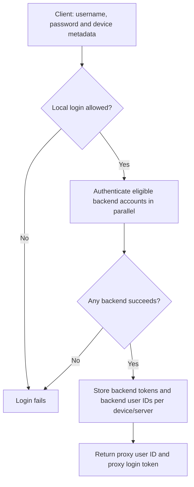
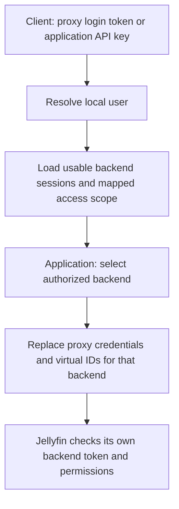
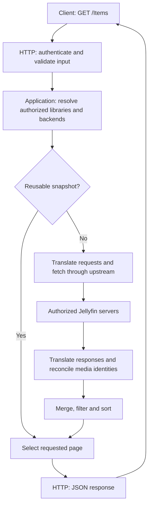
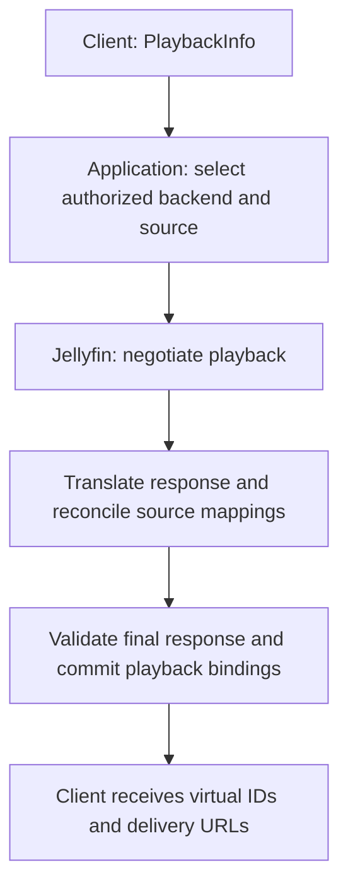
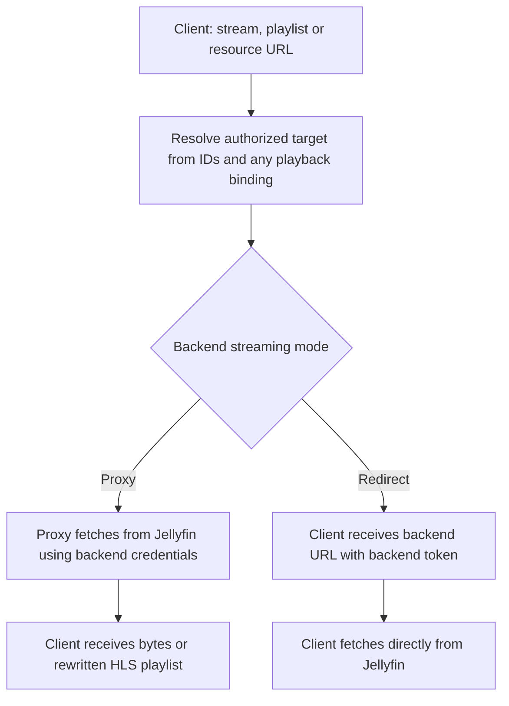
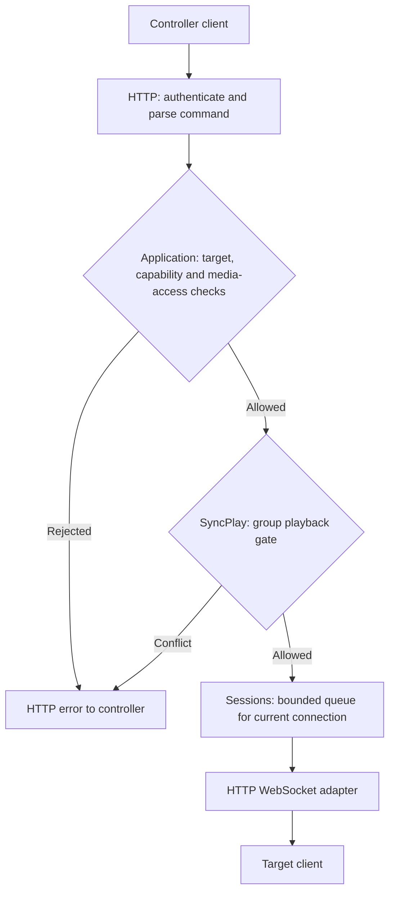

# Request and data flow

This guide follows authentication and client operations through the modules in
[Proxy architecture](../ARCHITECTURE.md). All code paths are relative to `src/`.
The arrows show runtime handoffs, not module dependency declarations.

## Before requests arrive

Startup constructs services in [app/composition.rs](app/composition.rs) and
assembles the client API and management UI in [app/router.rs](app/router.rs).
Handlers receive focused service handles from `http/state.rs`; they do not call
back into startup to find dependencies.

## Authenticating with backend servers

Jellyswarrm separates the **proxy login token** clients use from the **backend
tokens** Jellyfin servers accept.

### Logging in

The client posts a username and password to `/Users/AuthenticateByName`, with
Jellyfin client/device metadata in its authorization header.

- **Existing user:** the local credential must pass first. Only saved server
  mappings are tried, using their backend usernames and decrypted credentials;
  these can differ from the proxy login. A saved backend Quick Connect token is
  validated against its expected backend user instead of a password login.
- **New user:** if automatic user creation is enabled, the supplied credentials
  are tried on configured servers. At least one must succeed before the local
  user and successful mappings are created. Otherwise login is denied.

Backend session tokens are encrypted in storage. The login response substitutes
the local user's virtual IDs and uses the proxy token as its `AccessToken`.

**Code:** [login handler](http/client_routes.rs) →
[login orchestration](application/accounts.rs) →
[backend mapping authentication](auth/mapping_authentication.rs).

### Authenticating later requests

For a mapped user's request that needs a backend:

Tokens can arrive in supported Jellyfin authorization/token headers or an
`api_key`/`ApiKey` query parameter. Media requests reuse stored backend sessions,
matching device metadata when available and filtering for healthy servers; they
do not repeat password authentication on every request. A mapping defines access
scope but does not by itself provide a usable backend session.
Application API keys are read-only proxy credentials, not new Jellyfin tokens.

**Code:** [token resolution](application/accounts/identity.rs),
[media request collection](http/preprocessing/request.rs),
[stored sessions](auth/service/sessions.rs),
[outgoing credential replacement](application/request.rs).

These diagrams describe mapped-user authentication. Some forwarding/media paths
also allow backend-token passthrough; that does not authenticate a local user.
Proxy Quick Connect is an alternative client login: approval redeems existing
mappings, registers backend sessions and returns the same proxy token
([workflow](application/quick_connect.rs)). Management-page login is separate
under `ui/`.

## Browsing the catalog

A `GET /Items` request may combine results from several authorized Jellyfin
servers into one listing.

**Code:** [HTTP handler](http/client_routes.rs) →
[input extraction](http/extractors.rs) →
[catalog workflow](application/catalog/mod.rs).

The diagram shows a federated listing; single-owner requests can delegate to
`application/details/`. Application combines `processors/` for translation,
`upstream/` for transport and `media/` for identity storage. A reusable snapshot
already contains the processed listing; cache hits only paginate it. Incomplete
results are not cached, and incomplete or stale fetches must not erase newer
inventory.

## Starting and delivering playback

Choosing a playable source and delivering its bytes are separate requests.
The mapped-user path below uses media mappings and playback bindings to keep
them on the right backend.

### 1. Negotiate a source

Explicit source selections win over episode-server preferences. Bindings are
published only after reconciliation and final-response validation.

**Code:** [negotiation](application/playback/negotiation.rs),
[target selection](application/playback/target.rs).

### 2. Deliver the media

Delivery can use explicit media/source IDs without a prior `PlaybackInfo` request;
when a known binding is used, it must agree with the request's other routing inputs.
In proxy mode, HLS links are translated for subsequent proxy requests. In redirect
mode, the backend token is placed in the URL because redirects cannot forward an
authorization header.

**Code:** [delivery selection](application/playback/resources.rs),
[bindings](playback/sessions.rs),
[streaming and redirects](upstream/jellyfin/delivery.rs).

## Sending a remote-control command

`POST /Sessions/{id}/Playing` tells another connected client to play media. Unlike
stream delivery, the command stays inside Jellyswarrm.

**Code:** [session routes](http/sessions/routes.rs) →
[application checks and coordination](application/sessions/mod.rs) →
[WebSocket delivery](http/sessions/websocket.rs).

Application owns cross-feature authorization; SyncPlay owns group rules;
sessions own connection-aware queuing. Delivery failures also become HTTP errors.

Client sessions track presence and connections; playback bindings track media
routing. Accordingly, `/Sessions/Playing`, `/Sessions/Playing/Progress` and
`/Sessions/Playing/Stopped` are playback telemetry, not remote commands: they use
the media-report workflow and still reach the selected Jellyfin backend.
