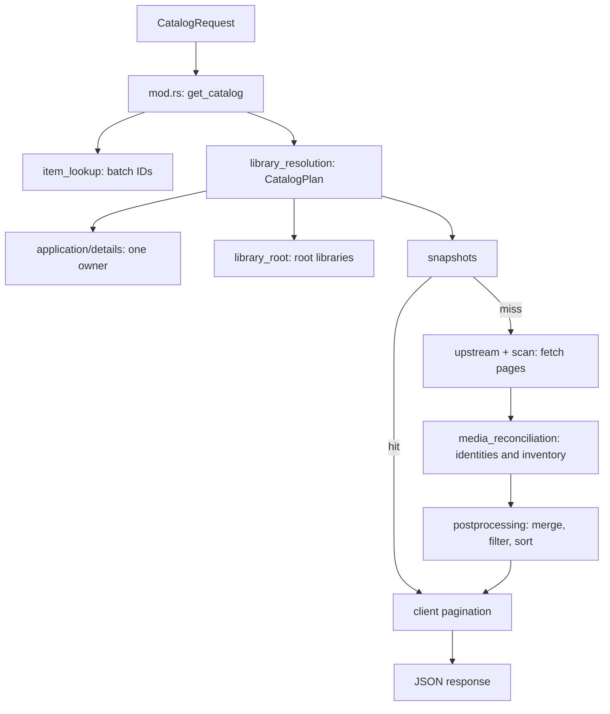

# Request and data flow

Paths are relative to `src/`. Start with `main.rs` for exact routes and aliases.

## Request routing

```text
Client → main.rs → extractors.rs → handlers/
                                  ├─ federated.rs  → application/catalog/mod.rs
                                  ├─ items.rs      → application/details/mod.rs
                                  │                → application/playback/negotiation.rs
                                  ├─ videos.rs     → application/playback/resources.rs
                                  ├─ livestreams.rs→ application/playback/live.rs
                                  └─ forwarding   → application/proxy.rs

Workflow → select authorized backend → upstream/jellyfin/request.rs
         → Jellyfin → process response / commit → handler → Client
```

Extractors collect caller identity and scope. Workflows select backends; the
request builder translates IDs and credentials. `handlers/pipeline_error.rs`
maps application failures to HTTP responses.

## Catalog

Modules below live in `application/catalog/` unless otherwise noted.



- `query.rs` interprets intent; `request_policy.rs` controls fetching.
- `refresh.rs` enters the shared fetch/reconciliation path without an HTTP request.
- Only authoritative, complete inventories can prune missing items; generation
  fences protect against stale updates.

## Playback

Negotiation and delivery are separate requests, connected by stored bindings.

```mermaid
sequenceDiagram
    participant C as Client
    participant N as playback/negotiation.rs
    participant J as Jellyfin
    participant S as Source/session storage
    participant D as playback/resources.rs
    C->>N: PlaybackInfo
    N->>N: target.rs selects owner/member
    N->>J: Translated request
    J-->>N: MediaSources
    N->>N: Translate and validate response
    N->>S: Reconcile sources; commit retained bindings
    N-->>C: Virtual IDs and delivery URLs
    C->>D: Stream / playlist / resource
    D->>S: Resolve source/session owner
    D->>J: Fetch resource (or redirect client)
    J-->>D: Bytes / playlist
    D-->>C: Stream / rewritten playlist / redirect
```

| Responsibility | Module |
|---|---|
| Owner/source selection | `application/playback/target.rs` |
| PlaybackInfo translation | `application/playback/response.rs` |
| Live open/refresh/close | `application/playback/live.rs` |
| Binding commits and revision fences | `application/playback/lifecycle.rs` |
| Reports and cancellation | `application/playback/reports.rs` |
| Streaming and HLS rewriting | `upstream/jellyfin/delivery.rs`, `hls.rs` |
| JSON adapter and wire normalization | `upstream/jellyfin/json.rs` |
| Shared response projection/observation | `application/response.rs` |

`application/*/services.rs` holds dependencies. Live identity preparation does
not publish bindings: commit follows reconciliation and final-payload validation.
